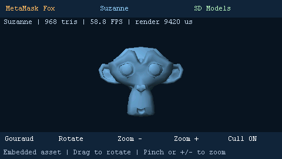

# dsp3D

An allocation-free C11 software-rendering library for Cortex-M, with a CMSIS-DSP
backend optimized for Cortex-M7 and complete STM32 Discovery model-viewer projects.

The library transforms each indexed vertex once per draw, clips against all six
frustum planes, and rasterizes RGB565 output with reciprocal-depth testing.
It supports flat shading, Gouraud shading, depth-tested wireframe, and points.
Camera, lighting, meshes, transforms, buffers, and renderer state are independent
of the board. Applications provide memory and handle presentation.

## Discovery demos

| Project | CPU | Display | Status |
| --- | --- | --- | --- |
| STM32F746G-Discovery | Cortex-M7, 200 MHz | 480 x 272 RGB LCD | Flashed and running; display and touch confirmed |
| STM32F769I-Discovery | Cortex-M7, 200 MHz | 800 x 480 DSI LCD | Flashed and running through J-Link; display and touch confirmed |

The touch viewer includes the MetaMask fox and Suzanne in flash, a read-only
microSD model browser, drag rotation, pinch/button zoom, automatic rotation,
culling controls, render-mode selection, FPS, and DWT cycle measurements. The
user button switches between embedded models. The demo works without a card.



MicroSD loading is implemented, including CRC/index/length validation and
transactional model replacement. No microSD was available during development:
physical SDMMC/card behavior remains unverified. Host model-loader tests and
the absent-card path are covered separately. See [validation](docs/VALIDATION.md).

## Measured performance

Measured on the **STM32F746G-Discovery at 200 MHz and 480 x 272**, with SDRAM,
I-cache/D-cache enabled, RGB565 double buffering, and the LCD scanning during
the benchmark. Each result is the mean of **120 deterministic poses**, timed
with the on-chip DWT cycle counter. Builds use ARM GNU 14.3.1, `-O3`, hard-float,
and `-ffp-contract=fast`, without `-ffast-math` or LTO.

All timings below are in **microseconds**. Fox: 188 triangles / 521 vertices;
Suzanne: 968 triangles / 505 smooth vertices.

| Model | Mode | CMSIS/DSP render | Scalar render | CMSIS/DSP clear |
| --- | --- | ---: | ---: | ---: |
| Fox | Flat | 6,449 | 6,431 | 2,667 |
| Fox | Gouraud | 7,183 | 8,358 | 2,646 |
| Fox | Wireframe | 3,367 | 3,357 | 2,656 |
| Fox | Points | 1,048 | 1,045 | 2,661 |
| Suzanne | Flat | 7,768 | 7,732 | 2,455 |
| Suzanne | Gouraud | 7,884 | 8,555 | 2,454 |
| Suzanne | Wireframe | 7,644 | 7,655 | 2,461 |
| Suzanne | Points | 1,086 | 1,088 | 2,463 |

Render time excludes clearing, UI, serial logging, and presentation/vblank waits.
Clear time includes DMA2D color fill and dirty-region depth clearing. The
interactive viewer was observed around **59 FPS in the tested poses**; render-only
timings are not end-to-end FPS, and results vary with pose, zoom and scene size.

The DSP backend reduces Gouraud render time by about **14% for the fox** and
**8% for Suzanne** against the scalar build using the same assets. Other modes
are close. During v2 optimization, clearing fell from about **7.3 ms to 2.5-2.7 ms**,
and Suzanne flat rendering from about **11.4 ms to 7.8 ms**. The latter includes
switching to shared smooth normals; these are not comparisons with the original
2016 renderer.

The **STM32F769I-Discovery at 200 MHz and 800 x 480** has also been measured with
the CMSIS/DSP backend, using the same assets and 120-pose benchmark. Mean timings
are in **microseconds**; no F769 scalar comparison was collected.

| Mode | Fox render | Fox clear | Suzanne render | Suzanne clear |
| --- | ---: | ---: | ---: | ---: |
| Flat | 16,028 | 5,374 | 14,286 | 5,026 |
| Gouraud | 18,419 | 5,361 | 15,442 | 5,014 |
| Wireframe | 4,625 | 5,366 | 9,840 | 5,009 |
| Points | 869 | 5,408 | 921 | 5,042 |

The F769 viewer was observed around **30 FPS with the fox at the default zoom**.
These measurements use its native resolution, which has about 2.94 times as many
pixels as the F746 display. See the [raw F769 results](docs/measurements/f769-dsp.csv)
for pose-dependent minima and maxima.

See the [full performance report](docs/PERFORMANCE.md) for methodology, optimization
details and reproduction commands, and the raw [DSP](docs/measurements/f746-dsp.csv)
and [scalar](docs/measurements/f746-scalar.csv) results for minima and maxima.

## Build and run on Windows

This supplied working folder contains the SDK, generated assets, and portable
tools inside the repository directory. Build scripts use repository-relative
paths and make no network requests or references to an external STM32Cube install.

```powershell
./tools/build.ps1 -Board f746
./tools/flash.ps1 -Board f746
./tools/monitor.ps1 -Port COM14 -Seconds 10
```

For the second board, select `-Board f769` in the build and flash commands.
For an onboard debugger converted to SEGGER J-Link, use
`./tools/flash.ps1 -Board f769 -Probe jlink`; its serial console is COM15 on the
verified workstation.
Output is in `build/f746/` or `build/f769/`: `viewer.elf`, `viewer.bin`,
`viewer.hex`, `viewer.map`, and the reusable `libdsp3d.a` archive.
The flash script verifies the MCU identity before programming. The OpenOCD
workflow supports the attached older ST-Link firmware without updating the probe.

**Portable tools in `tools/local/` are intentionally excluded from Git.** Copy the
complete working folder, including that directory, for an offline move. A fresh
Git clone needs local tool bundles populated as described in
[tools/README.md](tools/README.md); all firmware source dependencies are tracked.

## Use dsp3D as a library

Include `inc/dsp3D.h` and link `src/dsp3D.c` plus `src/dsp3D_model.c`, or use the
`dsp3d` CMake target. Supply an RGB565 buffer, a float depth buffer, and vertex
scratch memory to `dsp3d_init`. Begin a frame, draw one or more meshes, and present
the output with your platform backend. There is no allocation or storage access
inside the rendering loop. See [API and migration guide](docs/API.md).

Optimizations include:

- CMSIS fast trigonometry, single-precision FPU/FMA arithmetic, DSP halfword
  multiply-add edge setup, and saturating lighting lookup indices.
- Exact 1/16-pixel coverage with top-left edge ownership, incremental edge/depth/
  lighting updates, early backface rejection, and trivial clipping accept/reject.
- One transform per shared vertex, lighting only for modes that need it, and a
  cached 256-entry RGB565 shade palette with a division-free filled-pixel loop.
- Dirty-region depth clearing and unrolled word-sized stores; the board backend
  uses DMA2D color clears, coherent SDRAM caches, and vertical-blank buffer swaps.

Finite-value checks remain enabled: the builds use `-ffp-contract=fast` without
`-ffast-math`. A `-Scalar` build retains the equivalent FPU renderer for comparison.
Measured results and the reproducible benchmark procedure are in
[docs/PERFORMANCE.md](docs/PERFORMANCE.md).

## Models and microSD

The original STL files are preserved under `assets/source/`. The standard-library
Python converter accepts ASCII and binary STL, normalizes geometry, generates
normals, preserves crease edges, deduplicates vertices, and emits both typed C
assets and versioned `.d3m` files.

| Model | Triangles | Render vertices | Binary size |
| --- | --- | --- | --- |
| MetaMask fox, hard edges | 188 | 521 | 15,544 bytes |
| Suzanne, smooth normals | 968 | 505 | 27,640 bytes |

The fox uses an assigned orange material; STL does not supply the original
MetaMask material palette. Suzanne uses an assigned blue material. Model
provenance and separate licensing considerations are in [assets/README.md](assets/README.md).

Copy the contents of `sdcard/` to a FAT32 card so the files are in `/models`.
Tap **SD Models**, then select a file for preview. The viewer supports models up
to 2 MiB and 16,384 vertices. See [microSD instructions](docs/MICROSD.md) and
[binary format](docs/MODEL_FORMAT.md).

```powershell
./tools/regenerate-assets.ps1
./tools/local/python/python.exe tools/convert_model.py input.stl sdcard/models/model.d3m --color 79b8e8 --crease 60
```

## Tests, examples, and utilities

```powershell
./tools/test.ps1 -Benchmark
./build/native/preview.exe metamask build/fox.bmp 0
./build/native/preview.exe suzanne build/monkey.bmp 1
./build/native/preview.exe scene build/scene.bmp 1
./tools/monitor.ps1 -Port COM14 -Seconds 30 -Command b
./tools/capture.ps1 -Board f746 -Output build/display.png
```

Native tests cover the binary parser, malformed files, CRC, depth, culling,
normals, all rendering modes, shared-edge coverage, dirty clears, and clipping
stress with guard buffers. Python tests check deterministic asset reproduction
and both STL encodings. Assertions remain active in release test builds.

`examples/scenes` contains a triangle, a colored hard-edged cube, and multiple
independently transformed objects sharing a depth buffer. `examples/desktop`
provides a window-system-independent reference renderer and benchmark.
`examples/viewer` is the shared embedded application. [Board notes](docs/BOARDS.md)
describe memory ownership, caches, clocks, and port differences.

## History and license

The original 2016 engine, low-level template, and Blender exporter are preserved
in `legacy/`. The v2 typed API is a source-level change; migration is documented.
The original project was demonstrated on STM32F746, STM32F769, and STM32F429 boards:
[original demo](https://www.youtube.com/watch?v=GNKWmLiMpuk) and
[multiple demos](https://www.youtube.com/watch?v=HqQ-ebsyalM).

dsp3D code is [BSD-3-Clause](LICENSE.md), copyright 2016-2026 Fabio Angeletti.
Third-party software and supplied meshes retain separate terms; see
[THIRD_PARTY_NOTICES.md](THIRD_PARTY_NOTICES.md).
