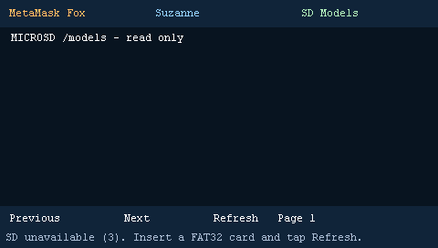

# Validation record

Development and validation date: 15 November 2026 (Europe/Rome).

## Passed

- Native GCC build with `-Wall -Wextra -Wpedantic -Werror`, assertions enabled.
- Native renderer tests: checked model opening, CRC reference vector, truncated
  data, bad alignment/version/checksum, non-finite model coordinates, depth,
  culling, all four rendering modes, translation-invariant normals, insufficient
  scratch, degenerate camera, exact shared-edge ownership, dirty/empty frame
  clears, and 1,000 deterministic clipping-stress cases with color/depth guards.
- Python converter tests: exact reproduction of checked-in binary assets,
  source triangle counts, finite/unit normals, malformed STL rejection, binary
  STL detection even with a misleading `solid` header.
- Independent native CMake/Ninja build and CTest run.
- Both board projects compile and link with ARM GCC 14.3.1. ELF program headers
  separate executable flash and writable non-executable data segments.
- Relocation check: copied build inputs and compiler to `build/relocation check`,
  restricted PATH to Windows System32, rebuilt both targets, and compared SHA-256
  hashes. Both firmware binaries matched the original builds exactly.
- F746 flash write and read-back verification through local OpenOCD, MCU ID
  0x449, ST-Link V2J24M11. Original 1 MiB flash preserved locally in
  `build/original-f746-flash.bin` before programming.
- F746 SDRAM probe passed. LCD updates, buffer swaps, both embedded models,
  serial commands, and all render modes exercised. The owner independently
  confirmed that the display and touch work.
- F746 deterministic on-board benchmarks captured for both scalar and DSP
  builds. See [performance](PERFORMANCE.md).
- F746 absent-card path returns FatFs result 3 (`FR_NOT_READY`), displays the
  recovery instructions, and continues presenting frames.
- Hardware RGB565 framebuffers read through SWD and visually inspected. These
  images show actual board output, not host mockups.
- Serial model switching retested after a long SWD halt. Explicit UART overrun
  recovery keeps commands working when the debugger pauses the receive loop.
- Native CMake library installation checked: static archive and public header
  install successfully into an independent prefix.

## Remaining physical checks

- No microSD is available. SDMMC transfers, FAT32 enumeration/loading with a real
  card, removal/reinsertion and physical-media errors are implemented but have
  not been exercised on hardware. Host binary-loader checks do not replace this.
- No STM32F769I-Discovery is attached. Its 200 MHz / 800 x 480 project is
  compile/link verified; DSI panel revisions, touch orientation, SDRAM and live
  performance require the physical second board.
- The supplied Windows native GCC distribution does not include the sanitizer
  runtime/spec files, so an attempted UBSan build was unavailable. Guard-buffer,
  exact coverage and deterministic stress tests passed without a sanitizer.

## Hardware captures

